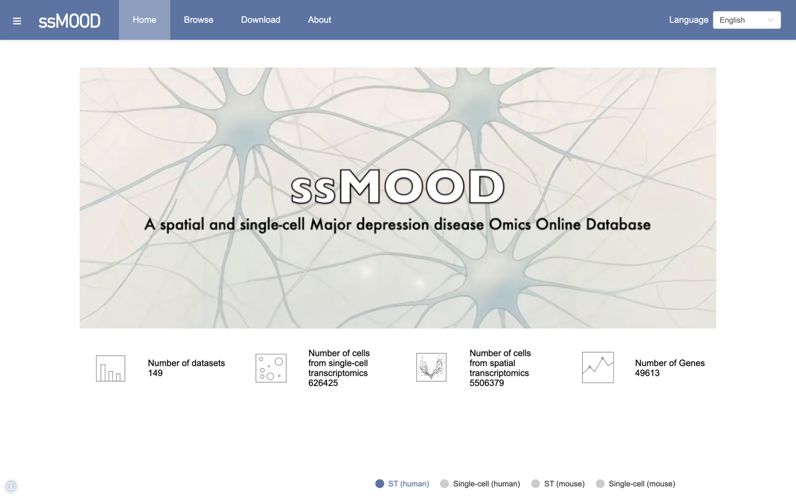
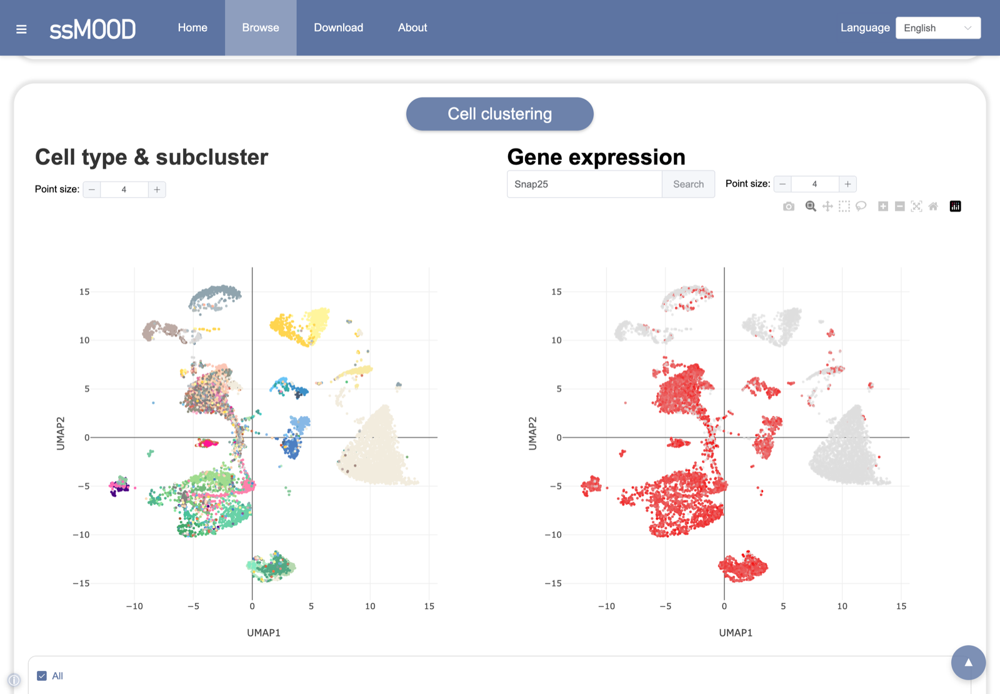
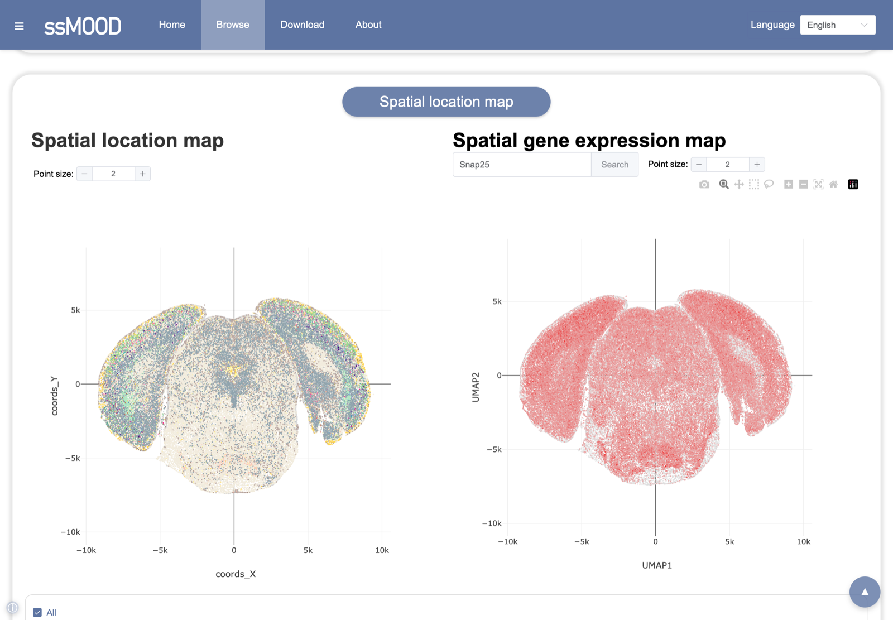
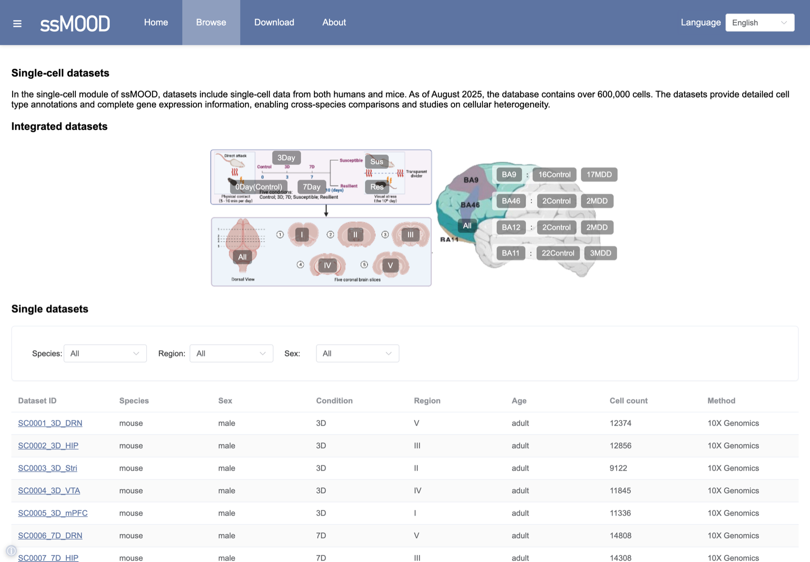
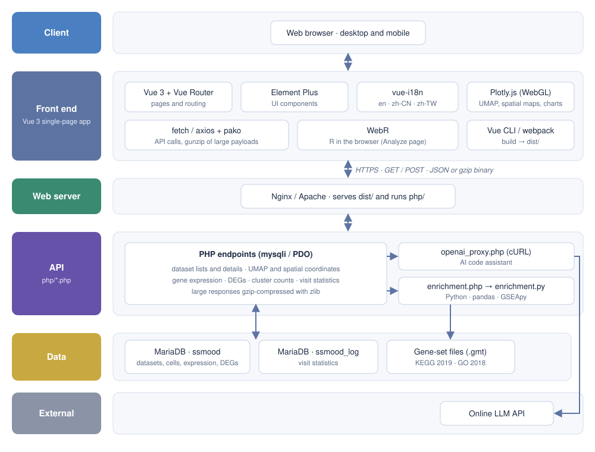

[](https://ssmood.genomics.cn)

# ssMOOD

**Spatial and single-cell Major depression disease Omics Online Database**

[](https://ssmood.genomics.cn)
[](https://www.gnu.org/licenses/agpl-3.0)

ssMOOD is an open, interactive database of single-cell and spatial transcriptomics data for **major depressive disorder (MDD)**. It brings human MDD data and the **chronic social defeat stress (CSDS)** mouse model into one place, so researchers can browse datasets, look up genes, and compare cell types across brain regions, conditions and species without downloading or processing raw data first.

👉 **Use it online: <https://ssmood.genomics.cn>**

This repository contains the full source code of the website: the Vue front end, the PHP API, and the Python enrichment script.

---

## Contents

- [What's in the database](#whats-in-the-database)
- [Features](#features)
- [Architecture](#architecture)
- [Repository layout](#repository-layout)
- [Run the front end locally](#run-the-front-end-locally)
- [Deploy your own instance](#deploy-your-own-instance)
- [Documentation](#documentation)
- [Contributing](#contributing)
- [Citation](#citation)
- [License](#license)

---

## What's in the database

| | |
|---|---|
| **Species** | Human (MDD and controls) · Mouse (CSDS days 0, 3 and 7, plus susceptible and resilient groups) |
| **Modalities** | Single-nucleus RNA-seq (10x Genomics, Singleron) · Spatial transcriptomics (Stereo-seq) |
| **Scale** | 600,000+ single-cell profiles and 5,500,000+ spatial spots, covering 49,000+ genes |
| **Organisation** | Individual datasets, plus integrated *studies* that combine related datasets |

Live counts are shown on the [home page](https://ssmood.genomics.cn). Dataset sources, protocols and processing steps are described in [Methods](public/doc/Methods.md).

## Features

- **Browse** single-cell and spatial datasets by species, brain region, condition and platform.
- **Dataset pages** with:
  - an interactive UMAP (single-cell) or spatial map (ST), coloured by cell type;
  - gene search, showing expression on the same embedding;
  - differentially expressed genes per cell type, with sorting and filtering;
  - KEGG and GO (BP / CC / MF) enrichment of the selected DEGs.
- **Integrated studies** that link several datasets, with synchronised charts.
- **Download** page with dataset links and the source code.
- **Analyze** page with an in-browser R environment (WebR) and an AI code assistant.
- English, Simplified Chinese and Traditional Chinese interface, chosen automatically from the browser language.

### Screenshots

**Single-cell dataset page**: UMAP coloured by cell type (left) and expression of a searched gene, *Snap25* (right).



| Spatial dataset page | Single-cell dataset browser |
|---|---|
|  |  |

## Architecture



| Layer | Technology |
|---|---|
| Front end | Vue 3, Vue Router, Element Plus, Plotly.js, vue-i18n, pako, WebR |
| API | PHP (mysqli / PDO), one endpoint per `php/*.php` file; large payloads are gzip-compressed |
| Database | MariaDB (`ssmood` for data, `ssmood_log` for visit statistics) |
| Enrichment | Python 3 with pandas and GSEApy, run by `php/enrichment.php` against the gene sets in `php/offline_enrich_db/` |

## Repository layout

```
.
├── doc/                     # Images used in this README
├── php/                     # PHP API endpoints, enrichment script and gene-set files
├── public/
│   ├── doc/                 # Methods, Usage and News pages shown on the website (Markdown)
│   └── index.html           # HTML shell and startup loading screen
└── src/
    ├── App.vue              # Root component
    ├── main.js              # App entry: router, i18n, Element Plus
    ├── config/index.js      # API base URL for development and production
    ├── router/index.js      # Routes
    ├── locales/             # en / zh-cn / zh-tw translations
    ├── styles/              # Global Element Plus theme overrides
    └── components/
        ├── HomeView.vue             # Home page
        ├── SingleCellList.vue       # Single-cell dataset list
        ├── SingleCellPage.vue       # Single-cell dataset page
        ├── STList.vue               # Spatial dataset list
        ├── STPage.vue               # Spatial dataset page
        ├── studySingleCellPage.vue  # Integrated single-cell study page
        ├── studySTPage.vue          # Integrated spatial study page
        ├── study/                   # Study overview cards
        ├── AnalyzePage.vue          # WebR + AI analysis page
        ├── DownloadPage.vue, DocPage.vue, ContactUsPage.vue, VisitLogPage.vue
        ├── general/                 # Shared components (navigation bar, loaders, footer, ...)
        ├── analyze/                 # Sub-components of the Analyze page
        ├── css/                     # Page styles
        ├── color_map.js             # Cell-type colour palette
        └── backup/                  # Deprecated components kept for reference
```

## Run the front end locally

Requirements: [Node.js](https://nodejs.org) 18 or newer, and npm.

```bash
git clone https://github.com/YuLab-SMU/ssMOOD.git
cd ssMOOD
npm install
```

Point the development build at a backend by editing `devConfig.apiUrl` in [`src/config/index.js`](src/config/index.js). For example, to use the public API:

```js
const devConfig = {
  apiUrl: 'https://ssmood.genomics.cn/php/',
};
```

Then start the dev server:

```bash
npm run serve        # http://localhost:8787
```

To build for production:

```bash
npm run build        # outputs to dist/
```

The production build calls the API at `./php/`, on the same host that serves the site.

## Deploy your own instance

Reference environment: Ubuntu 22.04, Apache 2, PHP 8.2, MariaDB 10.6, Python 3.10.

1. **PHP extensions**: `mysqli` (with mysqlnd), `pdo_mysql`, `zlib`, `curl`.
2. **Python packages** for enrichment: `pip install pandas gseapy`.
3. **Database**: create the `ssmood` and `ssmood_log` databases and load the data. Put the credentials in `/etc/ssmood/db.php`, outside the web root, and make the file readable only by the web server:

   ```php
   <?php
   return [
       'user' => 'db_user',
       'pass' => 'db_password',
   ];
   ```

   ```bash
   sudo chown www-data:www-data /etc/ssmood/db.php
   sudo chmod 600 /etc/ssmood/db.php
   ```

4. **Files**: copy the contents of `dist/` to the web root (e.g. `/var/www/html`), and the `php/` folder to `<web root>/php`.
5. **Apache**: enable `AllowOverride` for `<web root>/php` so that `php/.htaccess` takes effect. It blocks direct access to logs, scripts and gene-set files.
6. **AI assistant (optional)**: set the LLM endpoint, model and API key in `php/config.php` on the server. Never commit real keys.

## Documentation

- [Methods](public/doc/Methods.md): data sources, preprocessing, DEG and enrichment workflows
- [Usage](public/doc/Usage.md): a walkthrough of every page
- [News](public/doc/News.md): release notes and version mapping. The current release is **v1.1.1** (codebase 4.8.0).

The same pages are available on the website under **About**.

## Contributing

Issues and pull requests are welcome.

1. Fork the repository and create a branch from `master`.
2. Write code comments, commit messages and pull requests in English.
3. Run `npm run lint`, and make sure `npm run build` succeeds, before opening a pull request.

## Citation

The ssMOOD paper is in preparation. Until it is published, please cite the website:

> ssMOOD: Spatial and single-cell Major depression disease Omics Online Database. <https://ssmood.genomics.cn>

## License

ssMOOD is released under the [GNU Affero General Public License v3.0](LICENSE).

You may use, modify and redistribute it. Derivative works must be released under the same license. If you run a modified version as a network service, you must make its source code available to its users, for example with a link in the page footer.
